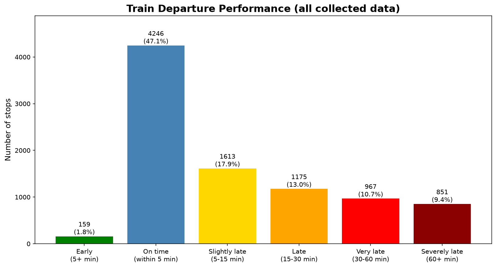
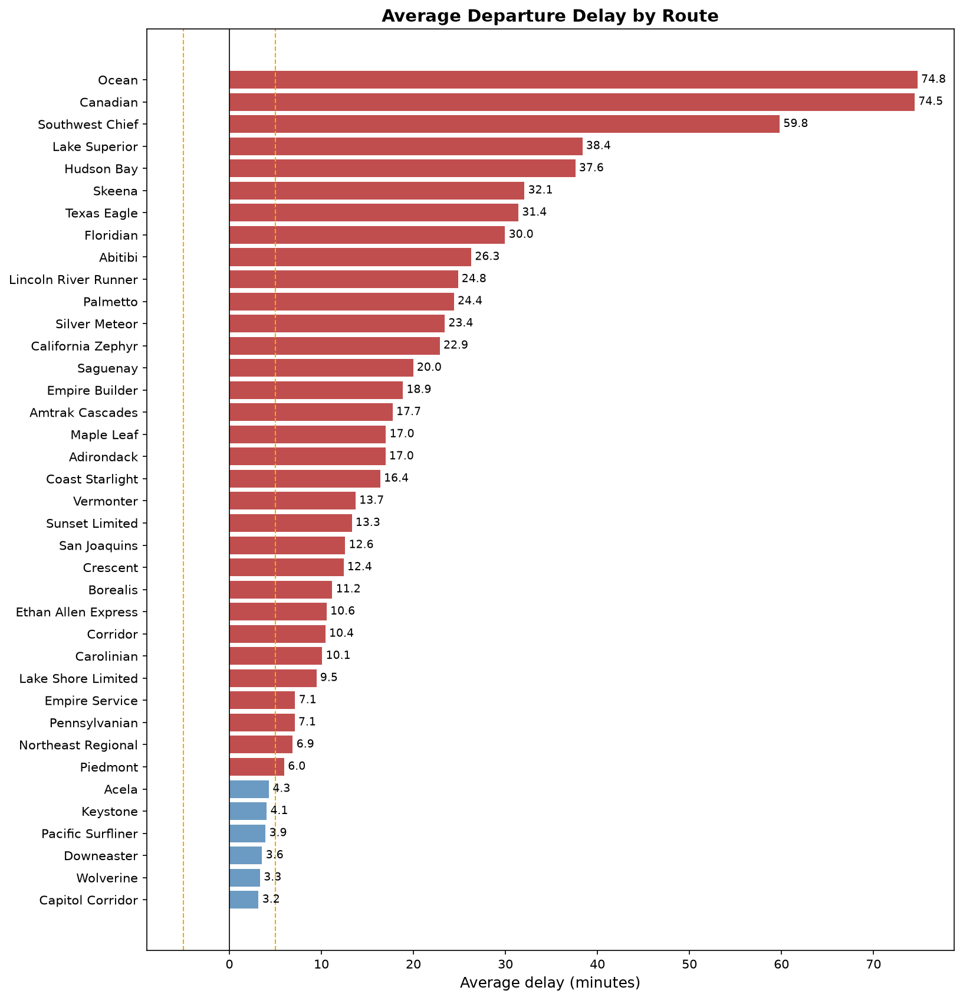
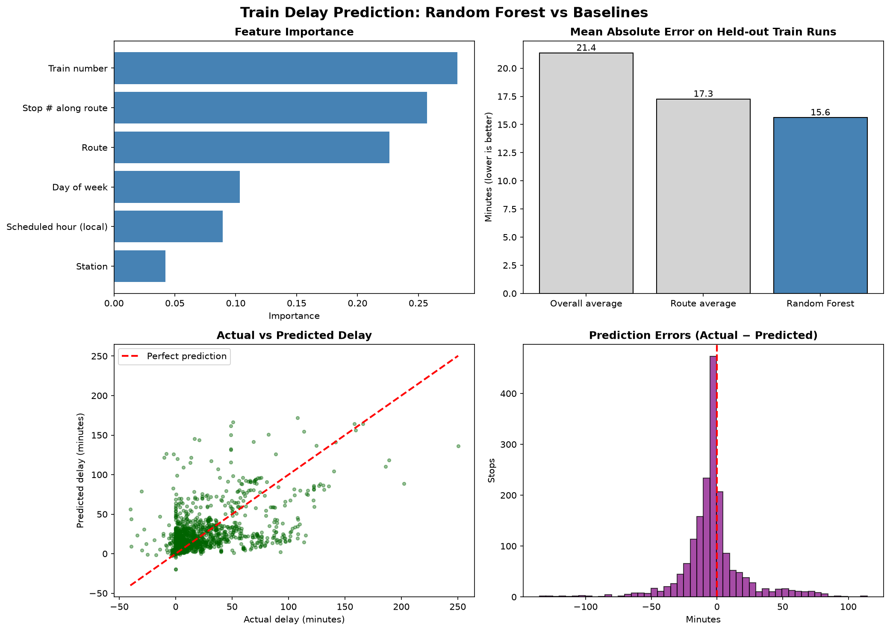

# Amtrak Delay Prediction & Route Performance Analysis

A data pipeline and model for studying why trains run late. It pulls real-time train data from the
[Amtraker API](https://api-v3.amtraker.com/v3/trains) on a schedule, builds a historical dataset of
station-level departures, analyzes which routes and trips accumulate delay, and trains a Random Forest
to predict how late a train will leave a given stop.

## Key findings

From 9,011 departed stops across 779 train runs (Aug–Oct 2025):

- **About a third of departures (34%) leave 15+ minutes late.** The median delay is 6 minutes.
- **Long-distance routes are the least punctual.** VIA Rail's *Ocean* and *Canadian* average about 75 minutes late,
  and Amtrak's *Southwest Chief* about 60. Short corridor services (*Capitol Corridor*, *Wolverine*, *Downeaster*,
  *Pacific Surfliner*, *Keystone*, *Acela*) average within 5 minutes of schedule.
- **Delays build up over a trip.** The median delay is 2 minutes in a train's first 5 stops and about an hour by stops 40–60.
- **The model beats simple baselines on trains it has never seen.** It predicts departure delay with a mean absolute
  error of 15.6 minutes, compared with 17.3 for "predict the route's average delay" and 21.4 for "predict the overall average".





## Model

`models.py` trains a `RandomForestRegressor` on six features: route, station, train number, stop number along the
route, scheduled hour (station local time), and day of week.

| Model | MAE (min) | RMSE (min) | R² |
|---|---|---|---|
| Predict overall average | 21.36 | 28.46 | -0.02 |
| Predict route average | 17.27 | 26.30 | 0.13 |
| **Random Forest** | **15.62** | **25.13** | **0.21** |

*Held-out test set of 156 train runs. 5-fold grouped cross-validation gives MAE 18.3 ± 2.4 for the Random Forest vs
20.2 ± 1.6 for the route-average baseline.*



### Evaluation design

The data comes from repeated API snapshots, so a naive random train/test split badly overstates accuracy. The
evaluation is designed to measure how well the model predicts delays for trains it has never seen:

1. **One row per stop.** Each 30-minute snapshot lists every stop of every active train, so the same stop appears in
   up to 10 snapshots. With duplicates, the model is tested on rows it already saw in training.
   `HistoricalDataManager.get_unique_stops()` keeps one row per stop per train run.
2. **Actual delays only.** For stops a train hasn't reached yet, the API reports an *estimated* time. Only stops
   with status `Departed` are used. Eight records claiming departures over an hour early are dropped as API errors.
3. **Split by train run, not by row.** Delays within one trip are strongly correlated, so every stop of a run goes to
   the same side of the split (`GroupShuffleSplit` / `GroupKFold` on `run_id`).
4. **Compare against baselines.** R² alone doesn't show whether the model learned anything useful. Comparing against
   route averages does.

## Data

- **Source:** [Amtraker API v3](https://api-v3.amtraker.com/v3/trains). It's free and needs no API key. It covers
  Amtrak and VIA Rail Canada trains (VIA train numbers start with `v`).
- **Collected:** 52,568 station records from 15 collection runs on Aug 7 and Oct 2, 7, and 8, 2025. Each snapshot
  includes multi-day long-distance trips already in progress, so the departures span Aug 3 – Oct 9.
- **Coverage:** 58 routes, 874 stations.

| File | Contents |
|---|---|
| `data/historical/all_stations.csv` | One row per stop per train per collection: scheduled vs actual arrival/departure (UTC), status, timezone, delay in minutes |
| `data/historical/all_trains.csv` | One row per train per collection: position, speed, heading, origin/destination |

## Project structure

| File | Purpose |
|---|---|
| `data_collector.py` | Calls the API and caches the raw JSON for 30 minutes |
| `automated_collection.py` | Flattens API data into station and train tables, appends them to the historical CSVs, and runs collection every 30 minutes |
| `models.py` | Trains and evaluates the delay model and saves `images/model_performance.png` |
| `historical_data_visualization.ipynb` | Analysis of the full historical dataset |
| `recent_data_visualization.ipynb` | Walkthrough of a single live API snapshot: raw JSON, flattening, current performance |
| `test_setup.py` | Checks packages, API access, and project files |

## Setup

Requires Python 3.11+ (tested on 3.14).

```bash
git clone https://github.com/walterga43/amtrack_delay_prediction.git
cd amtrack_delay_prediction
python -m venv .venv
# Windows: .venv\Scripts\activate    macOS/Linux: source .venv/bin/activate
pip install -r requirements.txt
python test_setup.py
```

## Usage

**Train and evaluate the model**
```bash
python models.py
```

**Explore the data**
```bash
jupyter notebook historical_data_visualization.ipynb
```

**Collect more data**
```bash
# Collects immediately, then every 30 minutes. Press Ctrl+C to stop.
python automated_collection.py
```
or once, from Python:
```python
from automated_collection import HistoricalDataManager
HistoricalDataManager().collect_and_store()
```

## Limitations and next steps

- **Small sample.** Collection ran on four separate days, so coverage of weekdays, seasons, and weather is thin.
  Running the collector continuously for a few months would help the most.
- **No upstream-delay feature.** For real-time prediction, a train's current delay at its previous stop would almost
  certainly be the strongest predictor. The current model predicts from schedule information alone.
- **Missing context.** Weather, track work, freight interference, and holiday schedules aren't included.

Last updated: November 2026
